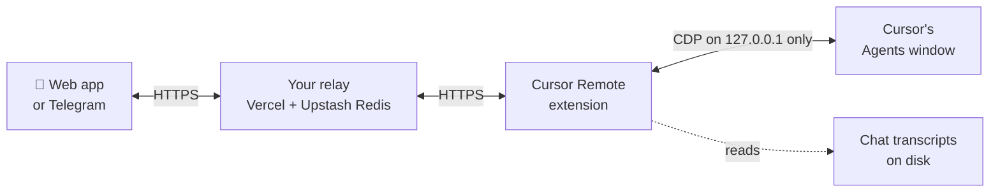

# Cursor Remote

[](LICENSE)
[](https://github.com/KrishnaGupta653/cursor-bridge/releases)
[](https://github.com/KrishnaGupta653/cursor-bridge/actions/workflows/ci.yml)

**Cursor's agents, in your pocket.** Start a long agent run, walk away, and keep it moving from your
phone: read every chat in Cursor's Agents window, send prompts, approve or reject commands, stop runs,
and get told when something finishes. From a web app or a Telegram bot, on any network.

**[Set it up (about 15 minutes) →](SETUP.md)** · **[Open the web app →](https://cursor-remote-app.vercel.app)**

---

## What you can do

**From the web app** ([cursor-remote-app.vercel.app](https://cursor-remote-app.vercel.app), add it to your home screen)

- **Cursor's Agents sidebar, live.** Pinned chats, repositories and groups as Cursor shows them, with
  running, unread and **Approval** marks that update as they change on the computer.
- **Chat like you're at the desk.** Live replies, the agent's work (edits, commands, diffs), model and
  mode switching, Stop, and New Chat.
- **Approve or reject** the exact command the agent is waiting on, after a confirm tap.
- **Notifications** when a chat finishes or needs approval while the tab is in the background, and a
  count in the tab title.
- **Pin, Unpin and Archive** chats, the same buttons Cursor shows on hover (long-press on a phone).
- **Still useful when the live view is off:** your pins and groups as Cursor last showed them, plus what
  to fix on the computer.

**From Telegram**

- `/chats` grouped like the sidebar, then just type to prompt the chat you picked.
- Approval alerts with confirm-to-approve, `/last` for the full latest reply, `/stop`, `/model`.
- `/pair` sends a one-tap sign-in link for your phone (single use, 5 minutes).
- Works on networks that block Telegram's Bot API, through Telegram's app protocol (MTProto).

**In Cursor**

- **Cursor Remote: Set Up** walks through everything: checks your relay, creates the Telegram settings
  (it finds your Telegram ID for you), shows a QR code for the phone, and turns on session control.
- **Cursor Remote: Diagnose** checks every part and names the one that's broken. The report contains no
  secrets.

## Quick start

1. **Install the extension** in Cursor: search **Cursor Remote** in the Extensions view, or install the
   `.vsix` from [Releases](https://github.com/KrishnaGupta653/cursor-bridge/releases).
2. **Deploy your relay** with one click (Vercel + Upstash Redis, both free):

   [](https://vercel.com/new/clone?repository-url=https%3A%2F%2Fgithub.com%2FKrishnaGupta653%2Fcursor-bridge%2Ftree%2Fmain%2Frelay-server&project-name=cursor-remote-relay&repository-name=cursor-remote-relay&stores=%5B%7B%22type%22%3A%22integration%22%2C%22integrationSlug%22%3A%22upstash%22%2C%22productSlug%22%3A%22upstash-kv%22%2C%22protocol%22%3A%22storage%22%7D%5D)
3. **Run Cursor Remote: Set Up** from the Command Palette and paste your relay's address.
4. **Scan the QR code** with your phone. Done.

Every step, with links and fixes for common problems, is in **[SETUP.md](SETUP.md)**.

## How it works



| Part | Folder | What it is |
|------|--------|------------|
| Extension | [`cursor-extension/`](cursor-extension/) | Runs inside Cursor: relay client, local WebSocket server for same-Wi-Fi use, Telegram bot, session control |
| Relay | [`relay-server/`](relay-server/) | Vercel functions + Upstash Redis that pass messages between phone and computer and drop them after 5 minutes |
| App | [`mobile-app/`](mobile-app/) | Flutter, deployed as the web app; also builds for Android and iOS |

**You run your own relay.** There is no shared server, so your chats only pass through infrastructure you
own. The web app is shared but stores nothing; your sign-in link tells it which relay to use.

**Session control** lets the phone send, stop and approve in Cursor's own Agents window, through the
Chrome DevTools Protocol on `127.0.0.1:9222`. That port is never exposed to the network. Without session
control the phone can still read chats.

## Security at a glance

- **Paired devices only.** Single-use pairing codes that expire in 5 minutes, 24-hour sessions, hashed
  capability tokens, and **Log out** revokes a phone.
- **Typed commands, no shell.** The phone can only send a fixed list of commands; terminal input, raw
  DevTools calls and arbitrary commands are rejected by both the relay and the extension.
- **Approvals are request-bound.** Approve or reject only acts on the exact request the phone showed,
  after a confirm tap, and never automatically.
- **Every remote action is audited** in the Cursor Remote output, and all of them can be turned off with
  `cursorRemote.remoteActions`.
- **Secrets stay local.** The Telegram token lives in a file only your user can read; Diagnose reports
  never contain tokens or codes.

Details and how to report a vulnerability: [SECURITY.md](SECURITY.md).

## Good to know

- **Cost:** free on Vercel Hobby, the Upstash free tier and Telegram for one person's use. Browser
  notifications make a hidden tab check the relay every 30 seconds, which uses more of the free quota.
- **Platforms:** tested on macOS. Windows and Linux work; [SETUP.md](SETUP.md) notes the differences.
  The computer has to stay awake.
- **Cursor updates:** reading the Agents window relies on Cursor's UI, which can change between releases.
  What can't be read is reported as unavailable, never made up.
- **Not yet:** renaming chats from the phone (Cursor has no button for it to press).

## Documentation

| Doc | For |
|-----|-----|
| [SETUP.md](SETUP.md) | Step-by-step setup with links, troubleshooting, reset and uninstall |
| [USER_MANUAL.md](USER_MANUAL.md) | Every feature and setting, same-Wi-Fi mode, CLI mode |
| [SECURITY.md](SECURITY.md) | Threat model and vulnerability reporting |
| [PROTOCOL.md](PROTOCOL.md) | Message format (protocol v2) and the full command list |
| [relay-server/README.md](relay-server/README.md) | Relay API and deployment |
| [docs/self-host-app.md](docs/self-host-app.md) | Hosting the web app yourself |
| [cursor-extension/CHANGELOG.md](cursor-extension/CHANGELOG.md) | What changed in each version |
| [cursor-extension/PUBLISHING.md](cursor-extension/PUBLISHING.md) | Releasing the extension |

## Develop

```bash
git clone https://github.com/KrishnaGupta653/cursor-bridge.git && cd cursor-bridge
npm ci
npm --workspace cursor-extension test               # extension: compile + unit tests
(cd relay-server && npm ci && npm test)             # relay: command policy + security tests
(cd mobile-app && flutter pub get && flutter test)  # app: widget and unit tests
```

- Run the app against a local relay:
  `flutter run -d chrome --dart-define=RELAY_URL=http://localhost:3000`.
- Package the extension: `cd cursor-extension && npx @vscode/vsce package --no-dependencies`.
- Branches follow Git Flow (`feature/*` from `develop`) with
  [Conventional Commits](https://www.conventionalcommits.org). Install the hooks with
  `./scripts/install-git-flow-hooks.sh`.

Issues and pull requests are welcome. Please include the **Diagnose** report with bug reports.

## License

MIT, see [LICENSE](LICENSE). By [Krishna Gupta](https://github.com/KrishnaGupta653).
